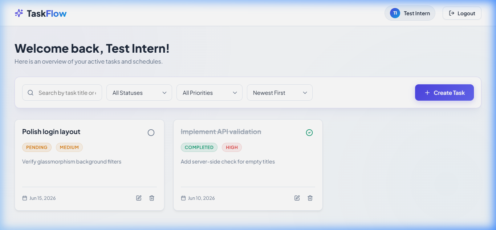

# TaskFlow

TaskFlow is a simple, clean task management web application built using the MERN stack (MongoDB, Express, React, and Node.js). It is designed to help users organize their daily tasks with ease in a modern dashboard interface.

---

## 📸 Application Previews

### 🎬 Full End-to-End Walkthrough (Demo Recording)


### 💻 Light-Theme Dashboard


### 🔑 Split-Panel Authentication


---

# Project Overview

### What the application does
TaskFlow allows users to create accounts, log in securely, and manage their personal to-do list. Users can create new tasks (with titles, descriptions, due dates, and priorities), view them on a dashboard, edit details, toggle statuses between pending and completed, and delete them. The dashboard also features real-time search, filters by status/priority, and pagination to handle list navigation.

### Why it was built
This project was built as part of a MERN Stack Internship Assignment. The goal was to build a fully functional CRUD application from scratch, demonstrate understanding of user authentication, state management, REST API endpoints, and clean CSS styling.

### Technologies used
The application is built on the MERN stack. The backend is an Express server communicating with a MongoDB database, and the frontend is a React application styled using custom CSS variables (without relying on Tailwind or Bootstrap) to demonstrate native CSS layout design.

---

# Features

* **User Registration**: Create a new account with a name, email, and password.
* **User Login**: Access personal workspaces with email and password verification.
* **JWT Authentication**: Secure API endpoints utilizing JSON Web Tokens stored in local storage.
* **Protected Routes**: Client-side (React Router) and server-side route protection.
* **CRUD Operations**: Add new tasks, edit existing tasks, delete tasks, and toggle status.
* **Search**: Search for tasks in real-time by title or description.
* **Filter**: Filter task grids by pending/completed status or priority levels (low, medium, high).
* **Pagination**: Slice tasks into multiple pages (6 tasks per page) for clean list display.

---

# Tech Stack

**Frontend:**
* React (Vite helper)
* React Router DOM
* Context API (Global auth state)

**Backend:**
* Node.js
* Express.js

**Database:**
* MongoDB
* Mongoose ODM

**Authentication:**
* JSON Web Tokens (JWT)
* bcryptjs (salted password hashing)

---

# Challenges Faced

* **Implementing JWT Authentication**: Setting up secure token generation on login, storing it safely in the client browser (`localStorage`), and designing middleware to verify the token for protected routes.
* **Managing Protected Routes**: Restricting pages like `/dashboard` on the frontend so that unauthenticated users are redirected back to the login page automatically.
* **Designing MongoDB Schemas**: Setting up relationships between the User and Task collections using foreign keys (`userId`) to guarantee that users can only see, edit, or delete their own tasks.
* **Handling Pagination and Filtering**: Writing database queries that combine text matching (regex for search), exact matching (for status and priority), sorting, and calculating offsets (`skip` and `limit`) for clean pagination.

---

# Future Enhancements

* **Dark Mode**: Add a dark/light theme switch for comfortable night usage.
* **Task Categories**: Allow grouping tasks into categories like "Work", "Personal", or "Study".
* **Email Notifications**: Alert users via email when a task's due date is approaching.
* **Drag and Drop Task Management**: Implement an interactive Kanban board (drag cards between columns).
* **Task Attachments**: Allow uploading files or images to tasks.

---

# Setup Instructions

Follow these simple steps to run the project locally on your machine.

### Method A: Using Docker (Quickest)

Make sure you have [Docker Desktop](https://www.docker.com/products/docker-desktop/) installed.

1. Open a terminal in the project root directory (`taskflow/`).
2. Run the launch command:
   ```bash
   docker-compose up --build
   ```
3. Once built, open:
   * **Frontend UI**: [http://localhost:5173](http://localhost:5173)
   * **Backend API**: [http://localhost:5000](http://localhost:5000)

---

### Method B: Manual Local Setup

Make sure you have [Node.js (v18+)](https://nodejs.org/) and a local instance of [MongoDB](https://www.mongodb.com/try/download/community) running.

#### 1. Backend Server Setup
1. Navigate to the backend folder:
   ```bash
   cd backend
   ```
2. Install dependencies:
   ```bash
   npm install
   ```
3. Create a `.env` file in the `backend/` folder and copy the values from `.env.example`:
   ```env
   PORT=5000
   MONGO_URI=mongodb://127.0.0.1:27017/taskflow
   JWT_SECRET=taskflow_jwt_secret_key_2026_fresher
   ```
4. Start the server:
   ```bash
   npm run dev
   ```

#### 2. Frontend React Client Setup
1. Open a new terminal and navigate to the frontend folder:
   ```bash
   cd frontend
   ```
2. Install dependencies:
   ```bash
   npm install
   ```
3. Create a `.env` file in the `frontend/` folder and copy the values from `.env.example`:
   ```env
   VITE_API_URL=http://localhost:5000/api
   ```
4. Launch the client:
   ```bash
   npm run dev
   ```
5. Open your browser and navigate to [http://localhost:5173](http://localhost:5173).
