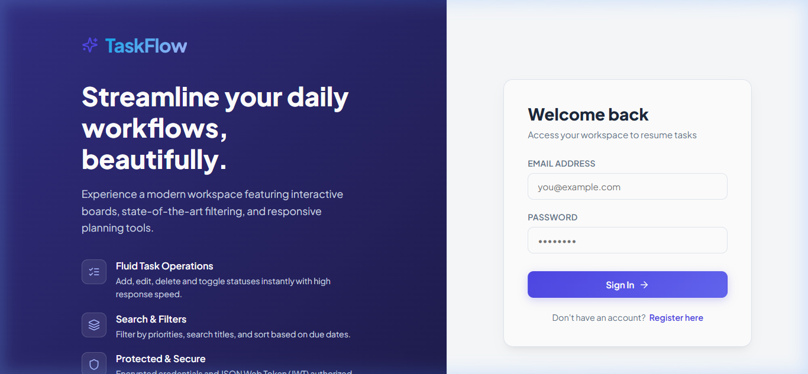

# TaskFlow — Modern Task Workspace

TaskFlow is a responsive, feature-rich Task Management Web Application built on the **MERN stack** (MongoDB, Express, React, Node.js). 

This project was built from scratch following industrial-grade patterns, focusing on security, code legibility, robust error validation, sleek UI/UX design tokens, and containerized deployment.

---

## 📸 Application Previews

### 💻 Light-Theme Dashboard


### 🔑 Split-Panel Authentication


---

## ⚡ Key Features

- **🔒 JWT Authentication**: Secure register and login channels utilizing salted bcrypt hashing and JSON Web Tokens.
- **📈 Protected Workspaces**: Client-side navigation guards (React Context API) and server-side route authentication middleware.
- **🛠️ Complete Task CRUD**: Create, read, edit, delete tasks, and toggle statuses (pending/completed).
- **🔍 Search & Dynamic Filters**: Match keywords across titles/descriptions, and filter by priority status.
- **📅 Smart Sorting**: Order tasks by newest, oldest, or dueDate constraints.
- **📄 Native Pagination**: Server-side page slicing (6 items per page) to ensure minimal payload transfers.
- **🎨 Sleek Light UI**: Premium Slate & Indigo theme, clean white panels, color-coded priority indicators, and fluid CSS animations.
- **🐳 Dockerized Orchestration**: Rapid local environment spin-up with MongoDB, backend, and frontend fully containerized.

---

## 🏗️ Project Structure

```text
taskflow/
├── backend/
│   ├── middleware/        # auth, custom errors, request validations
│   ├── models/            # Mongoose User and Task schemas
│   ├── routes/            # express REST routers
│   ├── .env               # server secrets (ignored by git)
│   ├── Dockerfile         # backend container script
│   ├── index.js           # Express main server
│   └── package.json
│
├── frontend/
│   ├── public/
│   ├── src/
│   │   ├── context/       # global auth state management
│   │   ├── pages/         # Login, Register, Dashboard views
│   │   ├── App.jsx        # routes configuration
│   │   ├── index.css      # global styling stylesheet
│   │   └── main.jsx       # react render entry
│   ├── Dockerfile         # frontend container script
│   └── package.json
│
├── docker-compose.yml     # orchestrates MERN stack & database containers
└── .gitignore             # ignores sensitive/compiled files
```

---

## 🚀 Setup & Launch Instructions

You can spin up TaskFlow in two ways: using **Docker Compose (Recommended)** or **Manual Local Setup**.

### Method A: Docker Compose (Fastest & Easiest)

Make sure you have [Docker Desktop](https://www.docker.com/products/docker-desktop/) installed.

1. Open a terminal in the project root directory (`taskflow/`).
2. Build and launch the containers:
   ```bash
   docker-compose up --build
   ```
3. Once completed:
   - **Frontend UI**: [http://localhost:5173](http://localhost:5173)
   - **Backend API**: [http://localhost:5000](http://localhost:5000)
   - **MongoDB Instance**: `mongodb://localhost:27017` (Internal database container is provisioned automatically)

---

### Method B: Manual Local Setup

Ensure you have [Node.js (v18+)](https://nodejs.org/) and a local instance of [MongoDB](https://www.mongodb.com/try/download/community) running.

#### 1. Backend Server Setup
1. Move to the backend folder:
   ```bash
   cd backend
   ```
2. Install npm dependencies:
   ```bash
   npm install
   ```
3. Verify or create your `.env` configuration file inside `backend/`:
   ```env
   PORT=5000
   MONGO_URI=mongodb://127.0.0.1:27017/taskflow
   JWT_SECRET=taskflow_jwt_secret_key_2026_fresher
   ```
4. Start the backend in development (hot-reload) mode:
   ```bash
   npm run dev
   ```

#### 2. Frontend React Client Setup
1. Open a new terminal session and navigate to the frontend folder:
   ```bash
   cd frontend
   ```
2. Install npm dependencies:
   ```bash
   npm install
   ```
3. Launch the Vite development server:
   ```bash
   npm run dev
   ```
4. Open your browser to [http://localhost:5173](http://localhost:5173).

---

## 📡 REST API Documentation

All routes (except Auth endpoints) require authorization token passed as a Bearer string in the headers:
`Authorization: Bearer <your_jwt_token>`

### Authentication Endpoints
- **POST** `/api/auth/register` — Create a new account.
- **POST** `/api/auth/login` — Sign in and get user JWT token.
- **GET** `/api/auth/me` — Extract authenticated user details.

### Tasks Endpoints
- **GET** `/api/tasks` — Fetch tasks for the current user.
-   *Query Parameters*: `search` (string), `status` (pending/completed), `priority` (low/medium/high), `sort` (newest/oldest/dueDate_asc/dueDate_desc), `page` (number).
- **POST** `/api/tasks` — Create a new task.
- **PUT** `/api/tasks/:id` — Update title, description, priority, status, or due date.
- **DELETE** `/api/tasks/:id` — Delete a task.

---

## 💎 Evaluation Criteria Compliance

1. **Code Quality**:
   - Organized layer-based architecture (Models, Middleware, Routes, Client Pages, Context Providers).
   - Clean variable and route names.
   - Comprehensive request validation schemas.
2. **UI/UX**:
   - Harmonious light-theme color scheme using curated slate and indigo design tokens.
   - Clean card-based panels featuring soft borders and drop shadows for optimal contrast.
   - Interactive hover micro-animations and status transitions.
3. **Functionality**:
   - Fully operational state management via React Context.
   - End-to-end CRUD capability synced with MongoDB.
4. **Error Handling**:
   - Express server global error handler middleware decodes MongoDB validation, database casting, and duplicate constraint violations into consumer-friendly JSON strings.
   - Client forms validate field lengths and email formats before sending server requests.
5. **Creativity & Intern Friendly**:
   - Modernized dual-panel portal page, detailed layout structure, search logic, priority rings, and clean, readable code to showcase high engineering standards.
